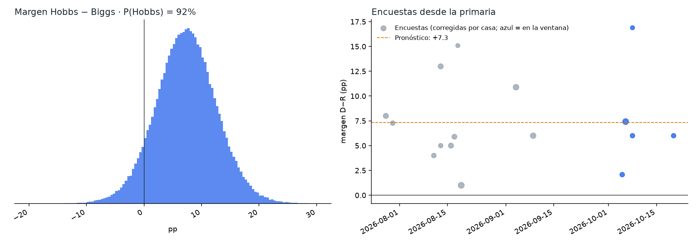
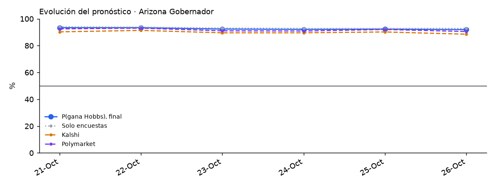

# Arizona 2026 · Gobernador

Elección general del 3 de noviembre de 2026 entre **Katie Hobbs (D, gobernadora en funciones)** y **Andy Biggs (R)**, con candidatos de terceros en la boleta.

<!-- PRONOSTICO:INICIO -->
**Pronóstico al 2026-10-26** (8 días a la elección) · actualizado automáticamente 2026-10-26 11:45 MST · fuentes en vivo 8/8

| Gobernador | % de voto (IC80) | Probabilidad de ganar |
|---|---|---|
| Katie **Hobbs** (D) | **51.7%** (48.2–55.3) | **92%** |
| Andy **Biggs** (R) | **44.4%** (40.8–47.9) | **8%** |
| Terceros | 3.9% (1.5–6.3) | — |

Margen D−R +7.3 pp (σ 5.3) · solo encuestas: P(Hobbs) 93% · Kalshi 88% · Polymarket 90% (peso de mercados 0.3) · recuento automático 2.7% · 16 encuestas, 4 encuestadoras en la ventana

**Encuesta más reciente:** GrayHouse (R), terminó el 2026-10-20 (**6 días** antes del corte). Las fuentes se consultan en vivo, pero el promedio solo puede ser tan reciente como la última encuesta publicada.

**Voto anticipado** (civicAPI, diagnóstico, al 2026-10-26): 937,650 boletas devueltas · D 38.4% · R 38.5% · otros 23.0% · Maricopa 60% del total

Detalle: [`resumen.txt`](produccion/salidas/ultimo/resumen.txt) · [encuestas usadas](produccion/salidas/ultimo/encuestas_gobernador.csv) · [escenarios](produccion/salidas/ultimo/escenarios_gobernador.csv) · [voto anticipado por condado](produccion/salidas/ultimo/voto_anticipado_condados.csv) · [historial](produccion/salidas/historial_pronosticos.csv)
<!-- PRONOSTICO:FIN -->

GitHub Actions actualiza el bloque anterior dos veces al día ([flujo](../.github/workflows/pronostico_arizona.yml)).

## Modelo general (elegido por backtest)
Base: el modelo V11 de Georgia, más lo que el backtest respaldó del modelo de la primaria de Arizona. El componente de encuestas se validó con un backtest *leave-one-year-out* de 782 contiendas (22 de Arizona), donde ganó el menor CRPS.

| Pieza | Cómo entra | Por qué |
|---|---|---|
| Promedio de encuestas | V11: efecto de casa contraído (k = 8), √n, vida media de 14 días, cada firma pesa ~1 | Mejor CRPS nacional (3.495) |
| Sesgo estatal | **No se usa** (escenario: con sesgo, P(Hobbs) ≈ 90 %) | Evidencia débil pero en la misma dirección: en AZ quitarlo baja el CRPS de 2.630 a 2.471 (22 contiendas, P = 0.85 por bootstrap de años) y en gobernadores de todo el país de 3.677 a 3.629 (256 contiendas, P = 0.65). En todas las contiendas nacionales el sesgo sí ayuda (P = 0.16 de que quitarlo mejore), por Presidente y Senado. No es concluyente: el escenario con sesgo se reporta siempre |
| Terceros | `real = 1.87 + 0.69 · (otros en encuestas)`, calibrado | El MAE del % demócrata bajó de 2.53 a 1.94 en AZ |
| Indecisos | 50/50 | Los escenarios por facción, el reparto proporcional y la cuota R estimada empeoran el CRPS |
| σ | `√(τ² + s²/k)` calibrada a los días que faltan, t de Student, más una deriva de 0.25 pp/día si las encuestas son más viejas que ese horizonte | Cobertura del 80 % correcta en el backtest |
| Mercados | Promedio de **Kalshi y Polymarket**, mezcla logit con peso 0.30. La distribución del margen se desplaza para que P(margen > 0) sea igual a la probabilidad publicada | No son el mismo precio (correlación de cambios diarios 0.16). Peso por máxima verosimilitud con 40 contiendas de 2024: 0.65 (IC95 0.25–1.00), pero 0.25 (IC95 0–0.65) al descontar el error común de 2024; 0.30 es compatible con ambos ([detalle](docs/03_peso_mercados.md)) |
| Recuento | P(\|margen\| ≤ 0.5 pp) | Recuento automático según la ley de AZ |
| Voto anticipado (civicAPI) | Diagnóstico, peso 0 | Sin histórico al mismo día para validarlo |
| Ajuste partidista | Solo escenario | No mejora el CRPS (3.579 frente a 3.545) |

## Qué valida y qué no valida el backtest

*Auditoría transversal del 26-oct-2026 (T4, T7). Detalle en [`docs/auditoria_2026-10-26.md`](../docs/auditoria_2026-10-26.md).*

- **Qué valida.** El backtest *leave-one-year-out* sobre el histórico de FiveThirtyEight + 2024 valida el **componente de encuestas** (promedio, efectos de casa, sesgo estatal) y su distribución de error (τ, s, ν). El número de contiendas depende del horizonte: con el corte de la corrida del 25/26-oct (9 días) la calibración de producción usa **906 contiendas**.
- **Qué no valida.** No es un backtest del pronóstico final que mezcla Kalshi/Polymarket con peso `w = 0.30`. Ese peso se estudió aparte con **40 contiendas de 2024** (un solo ciclo, con errores correlacionados): `w` de máxima verosimilitud 0.65 sin sesgo común y 0.25 con sesgo común libre (IC95 0–0.65). `w = 0.30` es compatible con ambos, no una validación entre ciclos. Ver [`arizona/docs/03_peso_mercados.md`](../arizona/docs/03_peso_mercados.md).
- **Margen y ganador son cosas distintas.** CRPS y MAE miden el margen; Brier y log score, el ganador. Una variante puede mejorar uno y no el otro.
- **Significancia.** Los valores P de esta página y de `docs/` comparan variantes **contienda por contienda**, como si las contiendas de un mismo año fueran independientes. Con bootstrap **por año** (26 años, 4,000 réplicas, 945 contiendas), la corrección por sesgo estatal mejora el CRPS nacional en −0.134, pero con IC95 [−0.320, +0.051], que incluye el cero (fracción de réplicas con empeoramiento: 0.077), y el Brier no cambia (+0.0009, IC95 [−0.004, +0.006]). La mejora observada es real en la muestra; la evidencia no alcanza para afirmar una ventaja robusta al 95 % entre ciclos. Se mantiene la regla vigente: se fijó antes de la elección y no se cambia con estos datos.
- **Fechas del histórico (T1).** FiveThirtyEight fecha cada encuesta en la mediana de su campo; producción usa el cierre. Recalibrar suponiendo que cada encuesta histórica estuvo disponible 2–4 días después de su mediana **no ensancha σ** (baja 0.1–0.3 pp; ν baja de 19.5 a ~13): no hay evidencia para aumentar la incertidumbre.

## Carpetas
| Carpeta | Contenido |
|---|---|
| [`produccion/`](produccion/) | Paquete `az_pronostico`. Todas las fuentes en vivo: Wikipedia, 270toWin, Kalshi, Polymarket, civicAPI y FiveThirtyEight. Incluye CLI, pruebas sin red y tarea programada de Windows. Ver su README. |
| [`modelo_general/`](modelo_general/) | Notebook final ejecutado (corte 21-oct-2026), el módulo del modelo, datos y salidas |
| [`backtest/`](backtest/) | Backtest de variantes (Georgia V11, primaria AZ, H1–H8), comparación Kalshi frente a Polymarket e ideas de On Point Politics (OP1–OP5) |
| [`docs/`](docs/) | Investigación del electorado, decisiones del modelo, revisión de On Point Politics y estimación del peso de los mercados |
