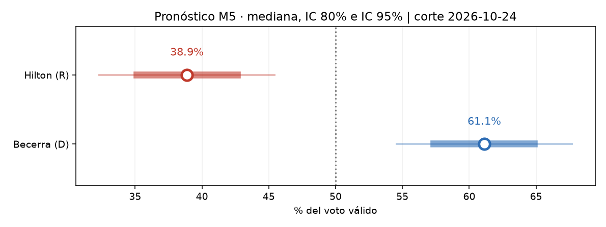
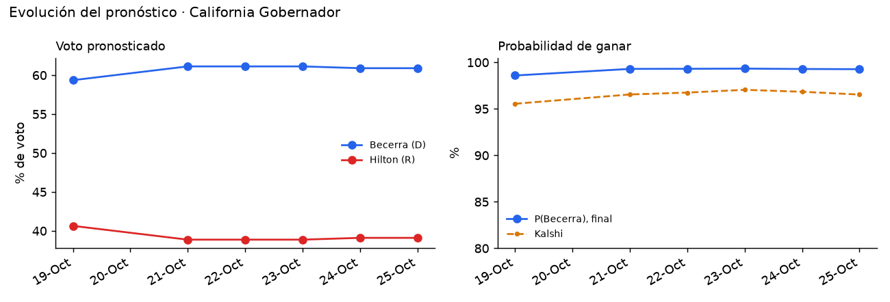

# California 2026 · Gobernador

Elección general del 3 de noviembre de 2026 entre **Xavier Becerra (D)** y **Steve Hilton (R)**, los dos primeros de la primaria *top-two* del 2 de junio.

<!-- PRONOSTICO:INICIO -->
**Pronóstico al 2026-10-25** (9 días a la elección) · actualizado automáticamente 2026-10-25 21:59 PT · fuentes en vivo 6/7

| Gobernador | % de voto (IC80) | Probabilidad de ganar |
|---|---|---|
| Xavier **Becerra** (D) | **60.9%** (57.2–64.6) | **99.3%** |
| Steve **Hilton** (R) | **39.1%** (35.4–42.8) | **0.7%** |

Margen D−R +21.8 pp (σ 6.5) · solo modelo: P(Becerra) 99.6% · Kalshi 96.5% (peso 0.30) · 15 encuestas (13 wikipedia, 2 base) · promedio M5 +21.8

**Encuesta más reciente:** McLaughlin & Associates (R), terminó el 2026-10-20 (**5 días** antes del corte). Las fuentes se consultan en vivo, pero el promedio solo puede ser tan reciente como la última encuesta publicada.

**Voto anticipado (Civiq, diagnóstico):** boletas devueltas D−R +21.0 a T−10 contra 2024 General +18.4 al mismo día.

Detalle: [`resumen.txt`](produccion/salidas/ultimo/resumen.txt) · [encuestas y pesos](produccion/salidas/ultimo/encuestas_pesos.csv) · [M5 frente a M1–M4](produccion/salidas/ultimo/comparacion_modelos.csv) · [historial](produccion/salidas/historial_pronosticos.csv)
<!-- PRONOSTICO:FIN -->

GitHub Actions actualiza el bloque anterior dos veces al día ([flujo](../.github/workflows/pronostico_california.yml)).

## Modelo M5 (híbrido)
M5 toma de cada versión anterior (M1–M4) solo lo que el backtest respalda:

| Pieza | Cómo entra | Por qué |
|---|---|---|
| Promedio de encuestas | vida media de 30 días; cada encuestadora cuenta ~1 vez (peso / √n); encuestas de campaña o partidistas a 0.5 | M1 corregido |
| σ | sistemática calibrada con el error histórico de las encuestas en California (2018–2025, RMSE ≈ 6.4 pp) + muestreo + deriva hasta la elección; colas t (ν = 5) | σ = 4.5 fija dejaba fuera la mitad de los casos al 80 % |
| Kalshi | mezcla logit, peso 0.30; ajusta solo la probabilidad publicada (margen, intervalos y % de voto son los del modelo) | no validado con historia; en Georgia y Arizona, en cambio, la distribución se desplaza hacia el mercado |
| Participación (Civiq) | diagnóstico, peso 0 | falló fuera de muestra en la primaria |
| Sentimiento (GDELT) | diagnóstico, k = 1 | sin serie histórica para validarlo |

## Carpetas
| Carpeta | Contenido |
|---|---|
| [`produccion/`](produccion/) | Paquete `ca_pronostico`: encuestas en vivo (Wikipedia, 270toWin) sobre una base verificada, Civiq, Kalshi y GDELT; CLI, 19 pruebas sin red y tarea programada de Windows. Ver su README. |
| [`modelo_m5/`](modelo_m5/) | Notebook M5 ejecutado (corte 19-oct-2026), datos y salidas |
| [`backtest/`](backtest/) | Backtest M1–M4 + Kalshi: σ empírica, primarias 2018/2024/2026, conteo de la primaria y mercados |
| [`docs/`](docs/) | Hallazgos del backtest y decisiones del modelo |

No se publica la serie de sentimiento propia (`entrega_sentimiento/`): en producción es opcional y solo de diagnóstico.
