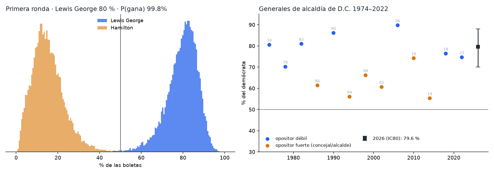
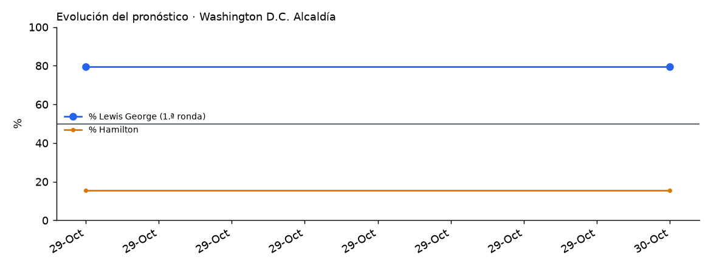

# Washington D.C. 2026 · Alcaldía

Elección general del 3 de noviembre de 2026 para suceder a Muriel Bowser (D), que no se presenta: **Janeese Lewis George (D)**, concejal del Ward 4, contra **Rhonda Hamilton (independiente)** y **Robert L. Gross (Statehood Green)**, más votos por escrito. Es la primera general de alcaldía con **voto preferencial (RCV, Iniciativa 83)**: si nadie pasa del 50 % de las boletas activas, se elimina al último y se transfieren sus votos.

<!-- PRONOSTICO:INICIO -->
**Pronóstico al 2026-10-29** (5 días a la elección) · actualizado automáticamente 2026-10-29 13:26 ET · fuentes en vivo 6/6

| Alcaldía (1.ª ronda RCV) | % de voto (IC80) | Probabilidad de ganar |
|---|---|---|
| Janeese **Lewis George** (D) | **79.6%** (70.0–88.1) | **>99%** |
| Rhonda **Hamilton** (I) | **15.4%** (6.3–25.3) | **<1%** |
| Robert L. **Gross** (Statehood Green) | 1.7% (0.5–3.3) | — |
| Votos por escrito | 3.3% (1.6–5.6) | — |

P(Lewis George gana en la primera ronda, > 50 %) **>99%** · P(≥ 70 %) 90% · P(≥ 80 %) 53% · margen sobre Hamilton +64.3 pp · base: **fundamentales** (13 generales 1974–2022; LOYO CRPS 4.5 pp, cobertura IC80 77%)

**Sin encuestas ni mercados de la general.** No hay ninguna encuesta Lewis George–Hamilton publicada y ni Kalshi (no_aplica) ni Polymarket (no_aplica) tienen mercado de esta elección; ambos se buscan en cada corrida y entran solos si aparecen (peso de mercados 0.0).

**Registro** (DCBOE, September 30, 2026): 453,471 votantes · demócratas 76.3 %, sin partido 17.3 %, republicanos 5.0 %. Contexto: D.C. no publica voto anticipado por partido y el registro no entra al pronóstico.

Detalle: [`resumen.txt`](produccion/salidas/ultimo/resumen.txt) · [generales 1974–2022](produccion/salidas/ultimo/historico_alcaldias.csv) · [escenarios](produccion/salidas/ultimo/escenarios_alcaldia.csv) · [validación LOYO](produccion/salidas/ultimo/validacion_loyo.csv) · [historial](produccion/salidas/historial_pronosticos.csv)
<!-- PRONOSTICO:FIN -->

GitHub Actions actualiza el bloque anterior dos veces al día ([flujo](../.github/workflows/pronostico_dc.yml)).

## Modelo general (elegido por backtest)
D.C. es el único estado del proyecto **sin encuestas ni mercados de la general** (28-oct: ninguna encuesta Lewis George–Hamilton; Kalshi 0 de ~15,300 eventos abiertos; Polymarket solo tuvo la primaria). Por eso el modelo no es el V11 de encuestas de los demás estados, sino uno de **fundamentales históricos** validado con las 13 generales de alcaldía 1974–2022, más el conteo RCV del modelo de la primaria ([`dc2026-rcv-forecast`](https://github.com/Zarate73/dc2026-rcv-forecast)).

| Pieza | Cómo entra | Por qué |
|---|---|---|
| % del demócrata (1.ª ronda) | `logit(%D) = a + b·opositor_fuerte` (M1), t de Student con la incertidumbre de los coeficientes | LOYO 13 elecciones: CRPS 4.49 pp; titular, % en la primaria, tendencia, σ por grupo y ponderación temporal no mejoran |
| Opositor fuerte | Concejal o alcalde (actual o anterior). Hamilton y Gross no lo son | Criterio fijado antes de ver resultados; separa 80.6 % de 62 % |
| Hamilton / Gross / por escrito | Gross ~ lognormal (mediana 1.3 %), por escrito ~ lognormal (mediana 3 %), Hamilton el resto (≥ 30 % del voto no demócrata) | Statehood Green no principal 1986–2014; por escrito 2014–2022 |
| RCV | Conteo de `run_rcv` del modelo de la primaria, vectorizado (`rcv.py`); agotamiento calibrado con la primaria certificada (escrito 54 %, candidatos 23 %) | Reproduce exacto las 7 tabulaciones certificadas del 16-jun; solo cambia algo si Lewis George < 50 % (≈ 0.3 %) |
| Encuestas de la general | Si aparecen: combinación por precisión en logit (sd 7 pp), indecisos proporcionales | Hoy no hay; lección de la primaria |
| Mercados | Si aparecen: mezcla logit, peso 0.30 | Igual que los demás estados; hoy no hay |
| Registro DCBOE | Diagnóstico | D.C. no publica voto anticipado por partido |

**Qué no valida el backtest:** la cola de derrota (el demócrata ganó las 13 elecciones), el reparto entre los menores y las transferencias RCV. Detalle en [`docs/01_investigacion_y_modelo.md`](docs/01_investigacion_y_modelo.md).

## Carpetas
| Carpeta | Contenido |
|---|---|
| [`produccion/`](produccion/) | Paquete `dc_pronostico`. Fuentes en vivo: Wikipedia (13 generales + 2026), DCBOE, Kalshi y Polymarket. CLI, pruebas sin red y tarea programada de Windows |
| [`backtest/`](backtest/) | Selección de variantes (LOYO), post-mortem del modelo de la primaria y contiendas certificadas 2014–2022 |
| [`docs/`](docs/) | Contexto, electorado, fuentes, decisiones del modelo y riesgos |
