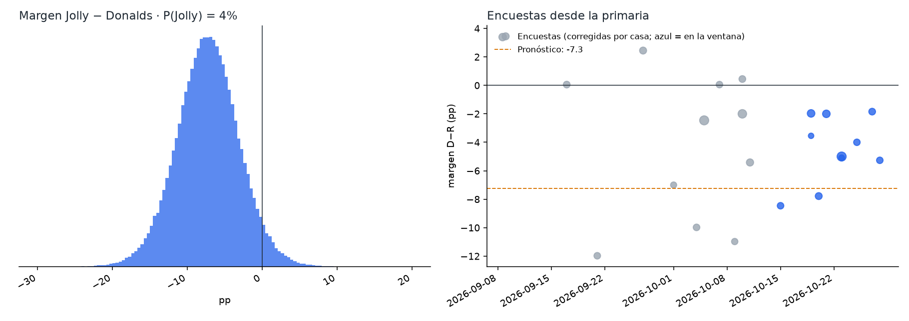
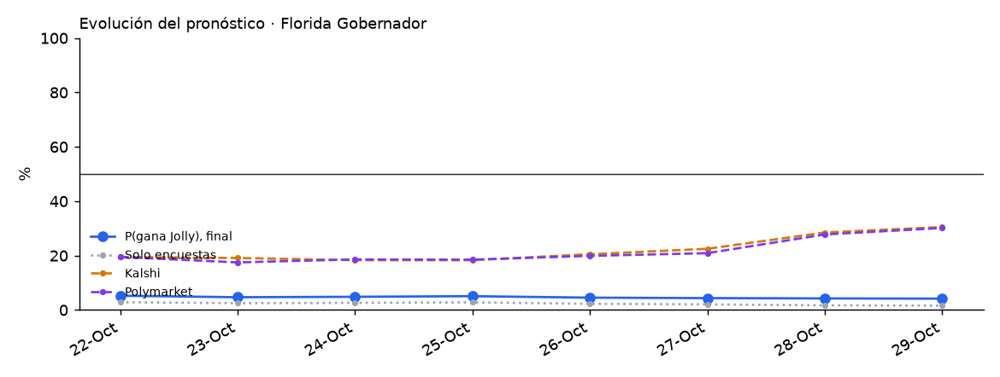

# Florida 2026 · Gobernador

Elección general del 3 de noviembre de 2026 entre **David Jolly (D)** y **Byron Donalds (R)**, con candidatos de terceros en la boleta. El gobernador Ron DeSantis no puede reelegirse.

<!-- PRONOSTICO:INICIO -->
**Pronóstico al 2026-10-29** (5 días a la elección) · actualizado automáticamente 2026-10-29 22:09 ET · fuentes en vivo 8/8

| Gobernador | % de voto (IC80) | Probabilidad de ganar |
|---|---|---|
| David **Jolly** (D) | **45.2%** (42.4–48.0) | **4%** |
| Byron **Donalds** (R) | **52.5%** (49.6–55.3) | **96%** |
| Terceros | 2.3% (0.2–4.4) | — |

Margen D−R -7.3 pp (σ 4.2) · solo encuestas: P(Jolly) 2% · Kalshi 30% · Polymarket 30% (peso de mercados 0.3) · recuento por máquina 2.0% · 22 encuestas, 10 encuestadoras en la ventana

Cómo se llega: promedio de encuestas -4.3 · sesgo estatal de Florida -4.9 (las encuestas de FL han sobreestimado al demócrata) · mercados +2.0

**Encuesta más reciente:** Siena College, terminó el 2026-10-28 (**1 días** antes del corte). Las fuentes se consultan en vivo, pero el promedio solo puede ser tan reciente como la última encuesta publicada.

**Voto ya emitido** (civicAPI, diagnóstico, al 2026-10-29): 4,265,855 (1,760,737 por correo, 2,505,118 en persona) · registrados D 38.5% · R 40.4% · NPA 18.6% (correo D+7.7, en persona R+8.6). Es registro de partido, no intención de voto: no entra al pronóstico.

Detalle: [`resumen.txt`](produccion/salidas/ultimo/resumen.txt) · [encuestas usadas](produccion/salidas/ultimo/encuestas_gobernador.csv) · [escenarios](produccion/salidas/ultimo/escenarios_gobernador.csv) · [voto anticipado por condado](produccion/salidas/ultimo/voto_anticipado_condados.csv) · [historial](produccion/salidas/historial_pronosticos.csv)
<!-- PRONOSTICO:FIN -->

GitHub Actions actualiza el bloque anterior dos veces al día ([flujo](../.github/workflows/pronostico_florida.yml)).

## Modelo general (elegido por backtest)
Base: el modelo V11 de Georgia. El componente de encuestas se validó con un backtest *leave-one-year-out* de 848 contiendas (1998–2024, 23 de Florida) a 12 días de la elección, con la misma ventana que producción (encuestas de los últimos 21 días; verificado contienda por contienda con el código de producción), donde ganó el menor CRPS. Del modelo de la primaria de Florida no se adoptó nada: todas sus piezas empeoraron el error en la general.

| Pieza | Cómo entra | Por qué |
|---|---|---|
| Promedio de encuestas | V11: efecto de casa contraído (k = 8), √n, vida media de 14 días, cada firma pesa ~1 | Mejor CRPS nacional (3.374) |
| Sesgo estatal | **Sí**, contraído por Bayes empírico (vida media de 4 años): hoy −4.8 pp hacia Donalds | Las encuestas de FL sobreestimaron al demócrata en 18 de 23 contiendas (2022 Gob +8.2, 2024 Pres +6.6, Sen +8.4). Quitarlo sube el CRPS de FL de 2.200 a 2.643 (P = 0.06 de que quitarlo mejore). Sin contraer da 2.168 en FL pero empeora a nivel nacional (P = 0.03). En validación estrictamente cronológica (todo estimado con años anteriores, 2004–2024) también gana: FL 2.136 vs 2.660 (P = 0.09), gobernadores del país 3.165 vs 3.244 (P = 0.23). Ambos quedan como escenario |
| Terceros | `real = 0.81 + 0.73 · (otros en las encuestas que los reportan)`; si ninguna los reporta (hoy), media histórica de contiendas sin reporte: 1.92 pp. «No reportado» ≠ 0 % (v1.1.0) | Frente a no modelar terceros, el MAE conjunto de % D y % R baja de 1.88 a 1.68 en FL (% D 2.10 → 1.51, aunque % R sube 1.65 → 1.86). A nivel nacional, distinguir «no reportado» mejora un poco (MAE conjunto 2.458 → 2.449) |
| Indecisos | 50/50 | La cuota R estimada (0.55) no mejora (2.209); el reparto de la primaria FIX v8 empeora (2.351) |
| σ | `√(τ² + s²/k)` calibrada a los días que faltan, t de Student, más una deriva de 0.25 pp/día si las encuestas son más viejas que ese horizonte | Cobertura del 80 % correcta en el backtest |
| Mercados | Promedio de **Kalshi y Polymarket**, mezcla logit con peso 0.30. La distribución del margen se desplaza para que P(margen > 0) sea igual a la probabilidad publicada | En FL los niveles se mueven juntos (0.86) pero los cambios diarios no (0.20). Peso estimado con 40 contiendas de 2024 ([detalle](../arizona/docs/03_peso_mercados.md)) |
| Recuento | P(\|margen\| ≤ 0.5 pp) | Recuento por máquina según la ley de FL |
| Escenarios | Cada uno con su probabilidad sin y con la misma mezcla de mercados; 2 × 2 sesgo × mercados explícito; sensibilidad a la contracción del sesgo (mitad, sin contraer), a la de los efectos de casa (k = 4 y 16) y a la deriva (doble) | Revisión externa del 22-oct ([detalle](docs/02_revision_externa_2026-10-22.md)) |
| Voto ya emitido (civicAPI) | Diagnóstico, peso 0 | Es registro de partido, no intención de voto, y no hay histórico al mismo día para calibrarlo |

## Qué valida y qué no valida el backtest

*Auditoría transversal del 26-oct-2026 (T4, T7). Detalle en [`docs/auditoria_2026-10-26.md`](../docs/auditoria_2026-10-26.md).*

- **Qué valida.** El backtest *leave-one-year-out* sobre el histórico de FiveThirtyEight + 2024 valida el **componente de encuestas** (promedio, efectos de casa, sesgo estatal) y su distribución de error (τ, s, ν). El número de contiendas depende del horizonte: con el corte de la corrida del 25/26-oct (9 días) la calibración de producción usa **945 contiendas**.
- **Qué no valida.** No es un backtest del pronóstico final que mezcla Kalshi/Polymarket con peso `w = 0.30`. Ese peso se estudió aparte con **40 contiendas de 2024** (un solo ciclo, con errores correlacionados): `w` de máxima verosimilitud 0.65 sin sesgo común y 0.25 con sesgo común libre (IC95 0–0.65). `w = 0.30` es compatible con ambos, no una validación entre ciclos. Ver [`arizona/docs/03_peso_mercados.md`](../arizona/docs/03_peso_mercados.md).
- **Margen y ganador son cosas distintas.** CRPS y MAE miden el margen; Brier y log score, el ganador. Una variante puede mejorar uno y no el otro.
- **Significancia.** Los valores P de esta página y de `docs/` comparan variantes **contienda por contienda**, como si las contiendas de un mismo año fueran independientes. Con bootstrap **por año** (26 años, 4,000 réplicas, 945 contiendas), la corrección por sesgo estatal mejora el CRPS nacional en −0.134, pero con IC95 [−0.320, +0.051], que incluye el cero (fracción de réplicas con empeoramiento: 0.077), y el Brier no cambia (+0.0009, IC95 [−0.004, +0.006]). La mejora observada es real en la muestra; la evidencia no alcanza para afirmar una ventaja robusta al 95 % entre ciclos. Se mantiene la regla vigente: se fijó antes de la elección y no se cambia con estos datos.
- **Fechas del histórico (T1).** FiveThirtyEight fecha cada encuesta en la mediana de su campo; producción usa el cierre. Recalibrar suponiendo que cada encuesta histórica estuvo disponible 2–4 días después de su mediana **no ensancha σ** (baja 0.1–0.3 pp; ν baja de 19.5 a ~13): no hay evidencia para aumentar la incertidumbre.

## Carpetas
| Carpeta | Contenido |
|---|---|
| [`produccion/`](produccion/) | Paquete `fl_pronostico`. Todas las fuentes en vivo: Wikipedia, 270toWin, Kalshi, Polymarket, civicAPI y FiveThirtyEight. Incluye CLI, pruebas sin red y tarea programada de Windows. Ver su README. |
| [`modelo_general/`](modelo_general/) | Notebook final ejecutado (corte 22-oct-2026), el módulo del modelo, datos y salidas |
| [`backtest/`](backtest/) | Backtest de variantes (Georgia V11, regla de Arizona, primaria de FL, H1–H8) y errores históricos de las encuestas en FL |
| [`docs/`](docs/) | Investigación del electorado (registro, primarias, voto ya emitido, indecisos), fuentes y decisiones del modelo |
