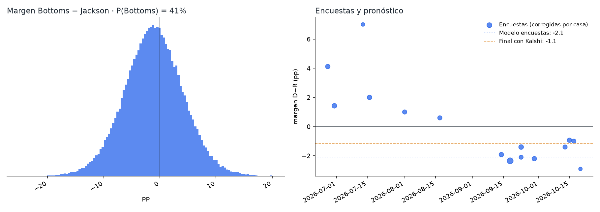
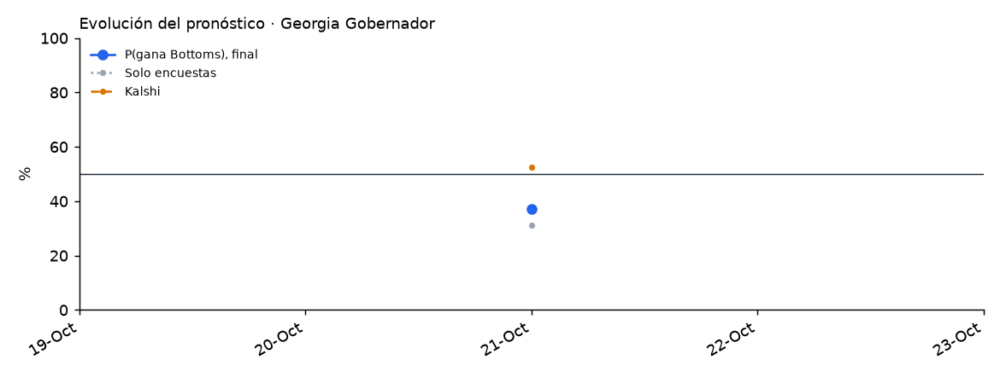

# Georgia 2026 · Gobernador (y Senado)

<!-- PRONOSTICO:INICIO -->
**Pronóstico al 2026-10-28** (6 días a la elección) · actualizado automáticamente 2026-10-28 14:15 ET · fuentes en vivo 7/7

| Gobernador | % de voto (IC80) | Probabilidad de ganar |
|---|---|---|
| Keisha Lance **Bottoms** (D) | **49.7%** (46.6–52.8) | **44%** |
| Rick **Jackson** (R) | **50.3%** (47.2–53.4) | **56%** |

Margen D−R -0.7 pp (σ 4.9) · solo encuestas: P(Bottoms) 37% · con Kalshi (peso 0.3) · segunda vuelta 0.2% · 16 encuestas, 5 encuestadoras en la ventana

**Encuesta más reciente:** Echelon Insights (R), terminó el 2026-10-23 (**5 días** antes del corte). Las fuentes se consultan en vivo, pero el promedio solo puede ser tan reciente como la última encuesta publicada.

**Senado:** Ossoff 54.5% · Collins 45.5% · P(Ossoff) 96% · Jackson+Ossoff 52% · Bottoms+Ossoff 43%

Detalle: [`resumen.txt`](produccion/salidas/ultimo/resumen.txt) · [encuestas usadas](produccion/salidas/ultimo/encuestas_gobernador.csv) · [escenarios](produccion/salidas/ultimo/escenarios_gobernador.csv) · [historial](produccion/salidas/historial_pronosticos.csv)
<!-- PRONOSTICO:FIN -->

El bloque anterior lo actualiza GitHub Actions dos veces al día ([flujo](../.github/workflows/pronostico_georgia.yml)).

| Carpeta | Contenido |
|---|---|
| [`produccion/`](produccion/) | Paquete `ga_pronostico`: Wikipedia, 270toWin, Kalshi, Civic Forge y FiveThirtyEight en vivo. `scripts\instalar.bat` y luego `scripts\correr_pronostico.bat`. Ver su README. |
| [`modelo_v11/`](modelo_v11/) | Notebook final V11 ejecutado (`GEORGIA_2026_MODELO_FINAL_V11.ipynb`), módulo, 17 pruebas y LEEME |
| [`backtest/`](backtest/) | Backtest LOYO de modelos y componentes (V5–V11), análisis de indecisos, Kalshi y observaciones externas |
| Encuesta propia G-Ratings | Solo resultados (24–29 sep 2026, 1,000 RV) en `produccion/data/ajustes_encuestas.csv` y en los CSV de encuestas; el Excel no se publica |
| [`docs/`](docs/) | 01 revisión de V9 · 02 backtest y selección · 03 modelo final V11 y revisión externa |

## Qué valida y qué no valida el backtest

*Auditoría transversal del 26-oct-2026 (T4, T7). Detalle en [`docs/auditoria_2026-10-26.md`](../docs/auditoria_2026-10-26.md).*

- **Qué valida.** El backtest *leave-one-year-out* sobre el histórico de FiveThirtyEight + 2024 valida el **componente de encuestas** (promedio, efectos de casa, sesgo estatal) y su distribución de error (τ, s, ν). El número de contiendas depende del horizonte: con el corte de la corrida del 25/26-oct (8 días) la calibración de producción usa **915 contiendas**.
- **Qué no valida.** No es un backtest del pronóstico final que mezcla Kalshi/Polymarket con peso `w = 0.30`. Ese peso se estudió aparte con **40 contiendas de 2024** (un solo ciclo, con errores correlacionados): `w` de máxima verosimilitud 0.65 sin sesgo común y 0.25 con sesgo común libre (IC95 0–0.65). `w = 0.30` es compatible con ambos, no una validación entre ciclos. Ver [`arizona/docs/03_peso_mercados.md`](../arizona/docs/03_peso_mercados.md).
- **Margen y ganador son cosas distintas.** CRPS y MAE miden el margen; Brier y log score, el ganador. Una variante puede mejorar uno y no el otro.
- **Significancia.** Los valores P de esta página y de `docs/` comparan variantes **contienda por contienda**, como si las contiendas de un mismo año fueran independientes. Con bootstrap **por año** (26 años, 4,000 réplicas, 945 contiendas), la corrección por sesgo estatal mejora el CRPS nacional en −0.134, pero con IC95 [−0.320, +0.051], que incluye el cero (fracción de réplicas con empeoramiento: 0.077), y el Brier no cambia (+0.0009, IC95 [−0.004, +0.006]). La mejora observada es real en la muestra; la evidencia no alcanza para afirmar una ventaja robusta al 95 % entre ciclos. Se mantiene la regla vigente: se fijó antes de la elección y no se cambia con estos datos.
- **Fechas del histórico (T1).** FiveThirtyEight fecha cada encuesta en la mediana de su campo; producción usa el cierre. Recalibrar suponiendo que cada encuesta histórica estuvo disponible 2–4 días después de su mediana **no ensancha σ** (baja 0.1–0.3 pp; ν baja de 19.5 a ~13): no hay evidencia para aumentar la incertidumbre.

## Modelo V11 en una línea
Promedio de encuestas corregido por efecto de casa − sesgo histórico de Georgia; σ empírica según el número de encuestadoras; colas Student-t; mezcla 70/30 con Kalshi; indecisos 50/50; solo write-ins como "otros".
