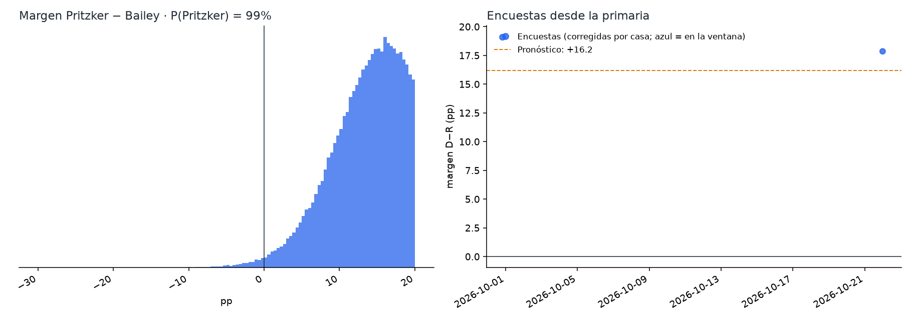
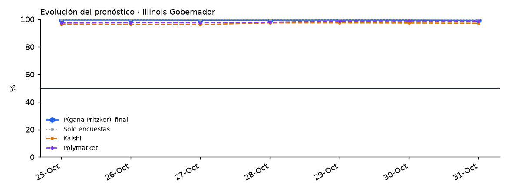

# Illinois 2026 · Gobernador

Elección general del 3 de noviembre de 2026 entre **JB Pritzker (D, gobernador en funciones)** y **Darren Bailey (R)**, revancha de 2022, con Collin Corbett (independiente). Gana la mayoría simple.

<!-- PRONOSTICO:INICIO -->
**Pronóstico al 2026-10-31** (3 días a la elección) · actualizado automáticamente 2026-10-31 11:21 CT · fuentes en vivo 8/8

| Gobernador | % de voto (IC80) | Probabilidad de ganar |
|---|---|---|
| JB **Pritzker** (D, gobernador) | **55.5%** (51.2–59.7) | **99%** |
| Darren **Bailey** (R) | **39.3%** (35.0–43.5) | **1%** |
| Terceros (Collin Corbett, I; otros) | 5.2% (3.2–7.3) | — |

Margen D−R +16.2 pp (σ 6.6) · solo encuestas: P(Pritzker) 99% · Kalshi 97% · Polymarket 99% (peso de mercados 0.3) · resultado muy estrecho (|margen| ≤ 0.5) 0.3% · 2 encuestas, 2 encuestadoras en la ventana

Cómo se llega: promedio de encuestas +18.2 · sesgo estatal de Illinois -0.9 · mercados -1.1

**Encuesta más reciente:** ActiVote, terminó el 2026-10-22 (**9 días** antes del corte). Las fuentes se consultan en vivo, pero el promedio solo puede ser tan reciente como la última encuesta publicada.

**Voto anticipado ya emitido** (civicAPI, diagnóstico, al 2026-10-31): 1,387,928 (768,303 en persona, 619,625 por correo) · 34 % del total de votos de 2022. Illinois no tiene registro partidario: es solo volumen, no indica el resultado y no entra al pronóstico.

Detalle: [`resumen.txt`](produccion/salidas/ultimo/resumen.txt) · [encuestas usadas](produccion/salidas/ultimo/encuestas_gobernador.csv) · [escenarios](produccion/salidas/ultimo/escenarios_gobernador.csv) · [voto anticipado por condado](produccion/salidas/ultimo/voto_anticipado_condados.csv) · [historial](produccion/salidas/historial_pronosticos.csv)
<!-- PRONOSTICO:FIN -->

GitHub Actions actualiza el bloque anterior dos veces al día ([flujo](../.github/workflows/pronostico_illinois.yml)).

## Modelo general (elegido por backtest)
Base: el modelo de Texas v1.1.0 (Maine / Pennsylvania / Nevada / Florida / Georgia V11). El componente de encuestas se validó con un backtest *leave-one-year-out* de 945 contiendas (1998–2024, 19 de Illinois) a 9 días de la elección, con la misma ventana que producción, más una validación estrictamente cronológica.

| Pieza | Cómo entra | Por qué |
|---|---|---|
| Promedio de encuestas | V11: efecto de casa contraído (k = 8), √n, vida media de 14 días, cada firma pesa ~1; ventana de 21 días, **ampliada hoy** (solo 2 encuestas: PPP y ActiVote) | Mejor CRPS nacional (3.304); ampliar es mejor que no ampliar (3.397 vs 3.670) |
| Identidad de las encuestas | Firma + periodo de campo; la fecha puntual de 270toWin es de publicación; cifras originales cuando la fuente redondea (ActiVote 58.7–41.3) | Revisiones de Texas e Illinois del 25-oct ([detalle](docs/02_revision_externa_2026-10-25.md)) |
| Sesgo estatal | Contraído por Bayes empírico con todas las contiendas del estado: hoy **suma** ~1.2 pp al demócrata | Cronológico IL: no significativo (sin sesgo P = 0.63); nacional: mejor en la prueba por contienda (P = 0.002), no concluyente con bootstrap por año (ver «Qué valida»); desde 2016 gana en IL |
| Terceros (Corbett) | `real = a + c·(otros en las encuestas que los reportan)` | Mejor regla en IL y a nivel nacional |
| Indecisos | 50/50 | El reparto proporcional es el peor en IL y a nivel nacional |
| Ventajas grandes | Sin ajuste de escala | b = 1.00 fuera de muestra; ajustar empeora (P = 0.13 en ventajas ≥ 15 pp) |
| σ | `√(τ² + s²/k)` calibrada a los días que faltan, t de Student, más una deriva de 0.25 pp/día | Cobertura del 80 % correcta en el backtest |
| Mercados | Promedio de **Kalshi y Polymarket**, mezcla logit con peso 0.30 | Peso estimado con 40 contiendas de 2024 ([detalle](../arizona/docs/03_peso_mercados.md)). Con probabilidades cercanas a 1 baja el margen (−2.1 pp): «sin mercados» y Polymarket por rangos son lecturas igual de defendibles |
| Voto anticipado (civicAPI) | Diagnóstico, peso 0; solo volumen por condado y ciudad | Illinois no tiene registro partidario |

## Qué valida y qué no valida el backtest

*Auditoría transversal del 26-oct-2026 (T4, T7). Detalle en [`docs/auditoria_2026-10-26.md`](../docs/auditoria_2026-10-26.md).*

- **Qué valida.** El backtest *leave-one-year-out* sobre el histórico de FiveThirtyEight + 2024 valida el **componente de encuestas** (promedio, efectos de casa, sesgo estatal) y su distribución de error (τ, s, ν). El número de contiendas depende del horizonte: con el corte de la corrida del 25/26-oct (9 días) la calibración de producción usa **945 contiendas**.
- **Qué no valida.** No es un backtest del pronóstico final que mezcla Kalshi/Polymarket con peso `w = 0.30`. Ese peso se estudió aparte con **40 contiendas de 2024** (un solo ciclo, con errores correlacionados): `w` de máxima verosimilitud 0.65 sin sesgo común y 0.25 con sesgo común libre (IC95 0–0.65). `w = 0.30` es compatible con ambos, no una validación entre ciclos. Ver [`arizona/docs/03_peso_mercados.md`](../arizona/docs/03_peso_mercados.md).
- **Margen y ganador son cosas distintas.** CRPS y MAE miden el margen; Brier y log score, el ganador. Una variante puede mejorar uno y no el otro.
- **Significancia.** Los valores P de esta página y de `docs/` comparan variantes **contienda por contienda**, como si las contiendas de un mismo año fueran independientes. Con bootstrap **por año** (26 años, 4,000 réplicas, 945 contiendas), la corrección por sesgo estatal mejora el CRPS nacional en −0.134, pero con IC95 [−0.320, +0.051], que incluye el cero (fracción de réplicas con empeoramiento: 0.077), y el Brier no cambia (+0.0009, IC95 [−0.004, +0.006]). La mejora observada es real en la muestra; la evidencia no alcanza para afirmar una ventaja robusta al 95 % entre ciclos. Se mantiene la regla vigente: se fijó antes de la elección y no se cambia con estos datos.
- **Fechas del histórico (T1).** FiveThirtyEight fecha cada encuesta en la mediana de su campo; producción usa el cierre. Recalibrar suponiendo que cada encuesta histórica estuvo disponible 2–4 días después de su mediana **no ensancha σ** (baja 0.1–0.3 pp; ν baja de 19.5 a ~13): no hay evidencia para aumentar la incertidumbre.

## Carpetas
| Carpeta | Contenido |
|---|---|
| [`produccion/`](produccion/) | Paquete `il_pronostico`. Todas las fuentes en vivo: Wikipedia, 270toWin, Kalshi, Polymarket, civicAPI y FiveThirtyEight. Incluye CLI, pruebas sin red y tarea programada de Windows |
| [`backtest/`](backtest/) | Backtest de variantes (sesgo estatal, indecisos, encuestas partidistas, terceros), validación cronológica del sesgo, ventana ampliada y escala de ventajas grandes |
| [`docs/`](docs/) | Investigación del electorado (voto anticipado por región, indecisos), contexto, fuentes y decisiones del modelo |
