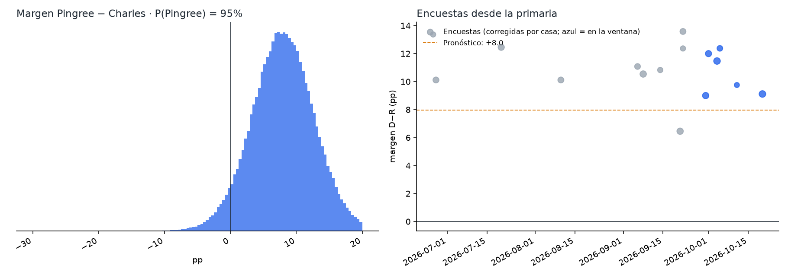
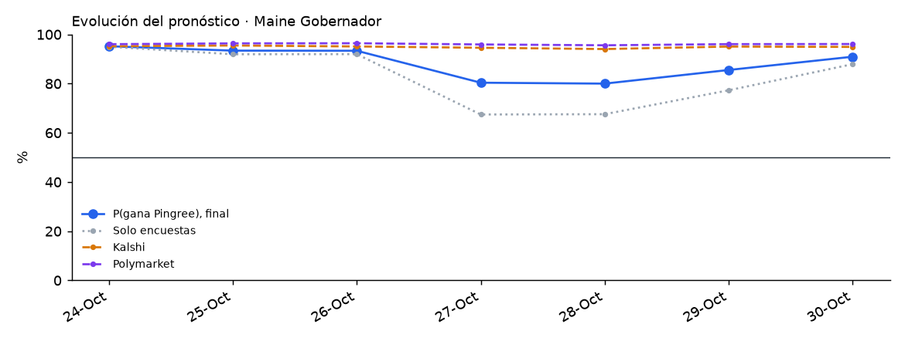

# Maine 2026 · Gobernador

Elección general del 3 de noviembre de 2026 entre **Hannah Pingree (D, ex presidenta de la Cámara estatal)** y **Bobby Charles (R)**, con **Rick Bennett (independiente)**. Elección abierta: Janet Mills no puede reelegirse. Gana la mayoría simple: la general de gobernador no usa voto preferencial.

<!-- PRONOSTICO:INICIO -->
**Pronóstico al 2026-10-24** (10 días a la elección) · actualizado automáticamente 2026-10-24 20:23 ET · fuentes en vivo 8/8

| Gobernador | % de voto (IC80) | Probabilidad de ganar |
|---|---|---|
| Hannah **Pingree** (D) | **50.6%** (47.4–53.8) | **95%** |
| Bobby **Charles** (R) | **42.6%** (39.4–45.8) | **5%** |
| Terceros (Rick Bennett, I) | 6.8% (4.6–9.0) | — |

Margen D−R +8.0 pp (σ 4.8) · solo encuestas: P(Pingree) 95% · Kalshi 95% · Polymarket 96% (peso de mercados 0.3) · resultado muy estrecho (|margen| ≤ 0.5) 1.9% · 16 encuestas, 6 encuestadoras en la ventana

Cómo se llega: promedio de encuestas +10.3 · sesgo estatal de Maine -2.4 · mercados +0.1

**Con independiente** (mayoría simple): P(Pingree gana) 95% · P(Bennett u otro tercero gana) en el modelo 0% (cota: los terceros se simulan como un total) · en los mercados Kalshi 2% y Polymarket 3%. La probabilidad de los mercados que entra a la mezcla es D / (D + R), condicional a que gane un partido principal.

**Encuesta más reciente:** Beacon Research (D)/Shaw & Co. Research (R), terminó el 2026-10-20 (**4 días** antes del corte). Las fuentes se consultan en vivo, pero el promedio solo puede ser tan reciente como la última encuesta publicada.

**Voto ausente ya emitido** (civicAPI, diagnóstico, al 2026-10-23): 179,532 (87,036 por correo, 92,496 en persona) · registrados D 50.3% · R 21.2% · no inscritos y otros 28.5%. Es registro de partido, no intención de voto, y el voto ausente es más demócrata que el electorado: no entra al pronóstico.

Detalle: [`resumen.txt`](produccion/salidas/ultimo/resumen.txt) · [encuestas usadas](produccion/salidas/ultimo/encuestas_gobernador.csv) · [escenarios](produccion/salidas/ultimo/escenarios_gobernador.csv) · [voto ausente por municipio](produccion/salidas/ultimo/voto_anticipado_condados.csv) · [historial](produccion/salidas/historial_pronosticos.csv)
<!-- PRONOSTICO:FIN -->

GitHub Actions actualiza el bloque anterior dos veces al día ([flujo](../.github/workflows/pronostico_maine.yml)).

## Modelo general (elegido por backtest)
Base: el modelo de Pennsylvania v1.1.0 (Nevada / Florida / Georgia V11). Se validó con un backtest *leave-one-year-out* de 923 contiendas (1998–2024, 13 de Maine) a 10 días de la elección, con la misma ventana que producción, más una validación estrictamente cronológica.

| Pieza | Cómo entra | Por qué |
|---|---|---|
| Promedio de encuestas | V11: efecto de casa contraído (k = 8), √n, vida media de 14 días, cada firma pesa ~1; ventana de 21 días, ampliada si hay menos de 2 encuestadoras | Mejor CRPS nacional (3.388) |
| Encuestadoras con varios nombres | Fox News = Beacon/Shaw, AARP = Fabrizio Ward/Impact, CNN = SSRS, NYT/PPH = Siena: se unifican con la clave del histórico de FiveThirtyEight. Las bipartidistas no se tratan como partidistas | Conservan su efecto de casa |
| Sesgo estatal | Contraído por Bayes empírico y **estimado sin contiendas de una sola encuestadora**: hoy se restan ~2.4 pp (las encuestas en Maine sobreestimaron al demócrata en 8 de 13 contiendas) | Con sesgo 3.32 vs sin sesgo 3.52 (cronológico P = 0.014). Sin contiendas k = 1 mejora en ME (P = 0.99) y a nivel nacional (P = 0.74); estimarlo por cargo empeora. «Con todas las contiendas» se reporta siempre |
| Independiente (Bennett) | `real = a + c·(otros en las encuestas que los reportan)`; un careo forzado sin Bennett cuenta como «no reportado» | En 139 contiendas con terceros ≥ 5 % el tercero se desinfla 1.1 pp y la regla ya lo corrige; ese voto no va claramente a ningún lado |
| Indecisos | 50/50 | El reparto proporcional es el peor en ME y a nivel nacional |
| σ | `√(τ² + s²/k)` calibrada a los días que faltan, t de Student, más una deriva de 0.25 pp/día si las encuestas son más viejas que ese horizonte | Cobertura del 80 % correcta en el backtest |
| Mercados | Promedio de **Kalshi y Polymarket**, mezcla logit con peso 0.30. Kalshi tiene un contrato de Bennett: se usa D / (D + R) | Peso estimado con 40 contiendas de 2024 ([detalle](../arizona/docs/03_peso_mercados.md)) |
| Resultado muy estrecho | P(\|margen\| ≤ 0.5 pp) | Maine no tiene recuento automático (lo pide un candidato) |
| Escenarios | Cruce 2 × 2 de sesgo × mercados, sesgo con todas las contiendas, influencia de cada encuesta, terceros con reducción, peso de mercados 0.15/0.50, **k efectivo y deriva por antigüedad ponderada** (ventana ampliada), Polymarket por rangos (condicional a que gane un partido principal) | Revisión del 24-oct ([detalle](docs/02_revision_externa_2026-10-24.md)) |
| Probabilidad con independiente | P(gana) exige superar a R y a los terceros; se reporta una cota de P(gana un tercero) y las probabilidades de Bennett de Kalshi y Polymarket | Mayoría simple sin voto preferencial |
| Voto ausente (civicAPI) | Diagnóstico, peso 0 | Es registro de partido; un tercio del padrón no está inscrito |

## Carpetas
| Carpeta | Contenido |
|---|---|
| [`produccion/`](produccion/) | Paquete `me_pronostico`. Todas las fuentes en vivo: Wikipedia, 270toWin, Kalshi, Polymarket, civicAPI y FiveThirtyEight. Incluye CLI, pruebas sin red y tarea programada de Windows |
| [`backtest/`](backtest/) | Backtest de variantes (sesgo estatal, indecisos, encuestas internas, terceros e independiente fuerte) y prueba de dónde estimar el sesgo |
| [`docs/`](docs/) | Investigación del electorado (registro, voto ausente, independiente, indecisos), contexto, fuentes y decisiones del modelo |
