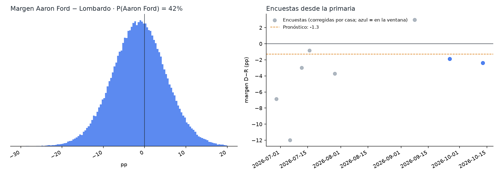
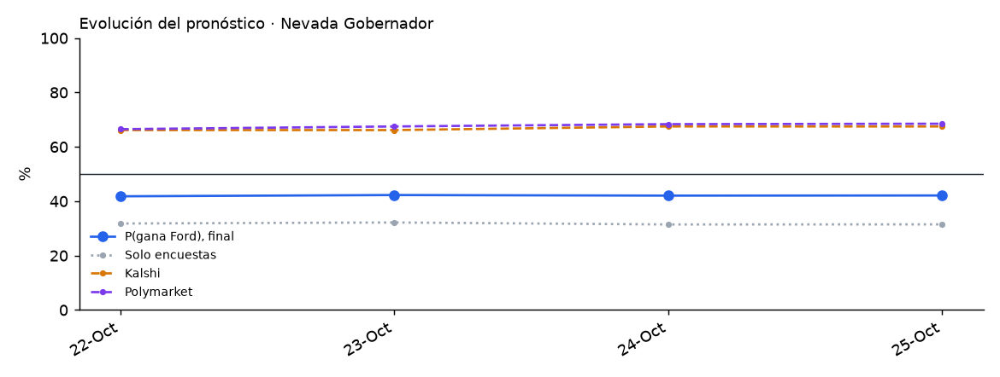

# Nevada 2026 · Gobernador

Elección general del 3 de noviembre de 2026 entre **Aaron Ford (D, fiscal general)** y **Joe Lombardo (R, gobernador en funciones)**. En la boleta también aparecen Danielle Ford (independiente) y la opción «None of these candidates».

<!-- PRONOSTICO:INICIO -->
**Pronóstico al 2026-10-23** (11 días a la elección) · actualizado automáticamente 2026-10-23 22:06 PT · fuentes en vivo 8/8

| Gobernador | % de voto (IC80) | Probabilidad de ganar |
|---|---|---|
| Aaron **Ford** (D) | **45.4%** (41.1–49.6) | **42%** |
| Joe **Lombardo** (R, gobernador) | **46.6%** (42.3–50.8) | **58%** |
| Terceros | 8.0% (5.8–10.2) | — |

Margen D−R -1.2 pp (σ 6.5) · solo encuestas: P(Ford) 32% · Kalshi 66% · Polymarket 68% (peso de mercados 0.3) · resultado muy estrecho (|margen| ≤ 0.5) 6.3% · 8 encuestas, 2 encuestadoras en la ventana

Cómo se llega: promedio de encuestas -2.2 · sesgo estatal de Nevada -0.6 · mercados +1.7

**Encuesta más reciente:** Global Strategy Group (D), terminó el 2026-10-13 (**10 días** antes del corte). Las fuentes se consultan en vivo, pero el promedio solo puede ser tan reciente como la última encuesta publicada.

**Voto ya emitido** (civicAPI, diagnóstico, al 2026-10-23): 324,538 (206,041 por correo, 118,497 en persona) · registrados D 39.3% · R 35.7% · otros e independientes 25.0% (correo D+9.0, en persona R+5.7). Es registro de partido, no intención de voto: no entra al pronóstico.

Detalle: [`resumen.txt`](produccion/salidas/ultimo/resumen.txt) · [encuestas usadas](produccion/salidas/ultimo/encuestas_gobernador.csv) · [escenarios](produccion/salidas/ultimo/escenarios_gobernador.csv) · [voto anticipado por condado](produccion/salidas/ultimo/voto_anticipado_condados.csv) · [historial](produccion/salidas/historial_pronosticos.csv)
<!-- PRONOSTICO:FIN -->

GitHub Actions actualiza el bloque anterior dos veces al día ([flujo](../.github/workflows/pronostico_nevada.yml)).

## Modelo general (elegido por backtest)
Base: el modelo de Florida v1.1.0 (Georgia V11). Se validó con un backtest *leave-one-year-out* de 848 contiendas (1998–2024, 23 de Nevada) a 12 días de la elección, con la misma ventana que producción, más una validación estrictamente cronológica.

| Pieza | Cómo entra | Por qué |
|---|---|---|
| Promedio de encuestas | V11: efecto de casa contraído (k = 8), √n, vida media de 14 días, cada firma pesa ~1; ventana de 21 días, ampliada si hay menos de 2 encuestadoras | Mejor CRPS nacional (3.375) |
| Sesgo estatal | Contraído por Bayes empírico: hoy +0.58 pp pro-D (pequeño) | En NV el error cambia de signo entre ciclos (8 de 23 contiendas pro-D, autocorrelación −0.11). Con todas las contiendas, quitarlo parece mejor (3.265 vs 3.321, P = 0.62), pero solo por 2014 (una encuestadora, error +22.8): sin 2014 el sesgo gana (2.521 vs 2.585; cronológico 2.443 vs 2.572, P = 0.23). «Sin sesgo» se reporta siempre |
| Encuestas internas de campaña | Con su efecto de casa; el ajuste por patrocinador queda como escenario | Descartarlas, pesarlas a la mitad o ajustarlas por patrocinador empeora el CRPS en NV (P ≤ 0.006) |
| Terceros | `real = a + c·(otros en las encuestas que los reportan)`; si ninguna los reporta, media histórica. Incluye a Danielle Ford y «None of these candidates» | Calibrado con el resultado real (100 − D − R) |
| Indecisos | 50/50 | El reparto proporcional gana en NV (3.166) pero es el peor a nivel nacional (3.650, P = 0.000): sería sobreajuste |
| σ | `√(τ² + s²/k)` calibrada a los días que faltan, t de Student, más una deriva de 0.25 pp/día si las encuestas son más viejas que ese horizonte | Cobertura del 80 % correcta en el backtest |
| Mercados | Promedio de **Kalshi y Polymarket**, mezcla logit con peso 0.30; la distribución del margen se desplaza para que P(margen > 0) sea la probabilidad publicada | En NV no son el mismo precio (cambios diarios con correlación −0.03). Peso estimado con 40 contiendas de 2024 ([detalle](../arizona/docs/03_peso_mercados.md)) |
| Resultado muy estrecho | P(\|margen\| ≤ 0.5 pp) | NV no tiene recuento automático (lo puede pedir un candidato) |
| Escenarios | Cruce 2 × 2 de sesgo × mercados. Influencia de cada encuesta (se quita y se reconstruye la ventana; sin GSG, P(Ford) sube de 42 % a 50 %). Sesgo sin contiendas de una sola encuestadora. Terceros con reducción moderada y pronunciada. Peso de mercados 0.15 y 0.50 | Revisión externa del 22-oct ([detalle](docs/02_revision_externa_2026-10-22.md)) |
| Voto ya emitido (civicAPI) | Diagnóstico, peso 0 | Es registro de partido, no intención de voto; el 39 % del padrón es no partidista |

## Carpetas
| Carpeta | Contenido |
|---|---|
| [`produccion/`](produccion/) | Paquete `nv_pronostico`. Todas las fuentes en vivo: Wikipedia, 270toWin, Kalshi, Polymarket, civicAPI y FiveThirtyEight. Incluye CLI, pruebas sin red y tarea programada de Windows |
| [`backtest/`](backtest/) | Backtest de variantes (sesgo estatal, indecisos, encuestas internas, terceros) y errores históricos de las encuestas en NV |
| [`docs/`](docs/) | Investigación del electorado (registro, no partidistas, voto anticipado, indecisos), fuentes y decisiones del modelo |
