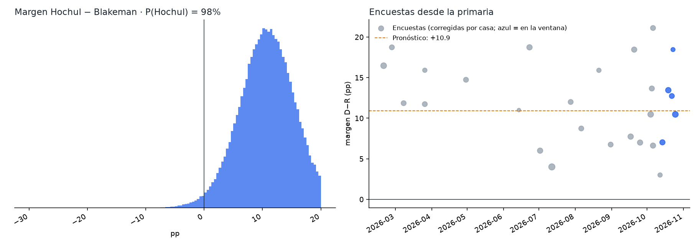
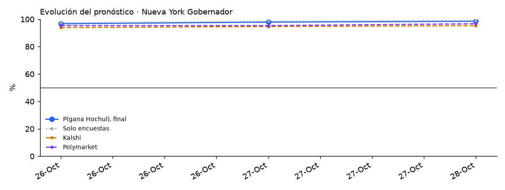

# Nueva York 2026 · Gobernador

Elección general del 3 de noviembre de 2026 entre **Kathy Hochul (D, gobernadora en funciones)** y **Bruce Blakeman (R, ejecutivo del condado de Nassau)**. No hay terceros en la boleta. Gana la mayoría simple.

<!-- PRONOSTICO:INICIO -->
**Pronóstico al 2026-10-28** (6 días a la elección) · actualizado automáticamente 2026-10-28 21:55 ET · fuentes en vivo 9/9

| Gobernador | % de voto (IC80) | Probabilidad de ganar |
|---|---|---|
| Kathy **Hochul** (D, gobernadora) | **55.4%** (52.3–58.5) | **98%** |
| Bruce **Blakeman** (R) | **44.5%** (41.4–47.6) | **2%** |
| Otros (votos por escrito) | 0.2% (0.1–0.2) | — |

Margen D−R +10.9 pp (σ 4.9) · solo encuestas: P(Hochul) 99% · Kalshi 95% · Polymarket 97% (peso de mercados 0.3) · resultado muy estrecho (|margen| ≤ 0.5) 0.7% · 27 encuestas, 5 encuestadoras en la ventana

Cómo se llega: promedio de encuestas +12.2 · sesgo estatal de Nueva York -0.3 · mercados -1.0

**Encuesta más reciente:** Marist University, terminó el 2026-10-25 (**3 días** antes del corte). Las fuentes se consultan en vivo, pero el promedio solo puede ser tan reciente como la última encuesta publicada.

**Voto anticipado en la Ciudad de Nueva York** (Junta Electoral de NYC, check-ins no oficiales, diagnóstico, día 5, al 2026-10-28): 357,027 en persona · Manhattan 99,121 · Bronx 37,212 · Brooklyn 105,516 · Queens 85,995 · Staten Island 29,183. Solo la ciudad, solo en persona y sin partido: no indica el resultado y no entra al pronóstico.

Detalle: [`resumen.txt`](produccion/salidas/ultimo/resumen.txt) · [encuestas usadas](produccion/salidas/ultimo/encuestas_gobernador.csv) · [escenarios](produccion/salidas/ultimo/escenarios_gobernador.csv) · [voto anticipado por condado](produccion/salidas/ultimo/voto_anticipado_condados.csv) · [historial](produccion/salidas/historial_pronosticos.csv)
<!-- PRONOSTICO:FIN -->

GitHub Actions actualiza el bloque anterior dos veces al día ([flujo](../.github/workflows/pronostico_new_york.yml)).

## Modelo general (elegido por backtest)
Base: el modelo de Illinois v1.1.0 (Texas / Maine / Pennsylvania / Nevada / Florida / Georgia V11). El componente de encuestas se validó con un backtest *leave-one-year-out* de 945 contiendas (1998–2024, 20 de Nueva York) a 9 días de la elección, con la misma ventana que producción, más una validación estrictamente cronológica.

| Pieza | Cómo entra | Por qué |
|---|---|---|
| Promedio de encuestas | V11: efecto de casa contraído (k = 8), √n, vida media de 14 días, cada firma pesa ~1; ventana de 21 días (hoy: Quinnipiac, OnMessage (R) 12–14 oct y ActiVote) | Mejor CRPS nacional (3.304). Las encuestas del 1–12 oct quedan fuera; los escenarios de 45 días y de fecha media las incluyen |
| Identidad de las encuestas | Firma + periodo de campo; Siena SRI ≠ NYT/Siena; decimales del Excel verificado cuando Wikipedia redondea; encuestas que faltan en las fuentes web, desde `data/encuestas_complementarias_ny.csv` ([revisión del 26-oct](docs/02_revision_externa_2026-10-26.md)) | Conservan su efecto de casa y sus cifras originales |
| Sesgo estatal | Contraído por Bayes empírico con todas las contiendas del estado: hoy **resta** ~1.9 pp (desde 2020 las encuestas en NY sobreestimaron al demócrata) | El estado donde más ayuda: LOYO 2.929 vs 3.419 sin sesgo; cronológico 2.487 vs 2.718; «k ≥ 2» y «por cargo» peores |
| Terceros | Solo dos candidatos en la boleta: votos por escrito fijos (0.15 %) | La Junta Electoral rechazó las demás peticiones; 2022: 0.16 % |
| Indecisos | 50/50 | El reparto proporcional y la cuota R son peores en NY y a nivel nacional |
| Ventajas grandes | Sin ajuste de escala | b = 1.00 fuera de muestra |
| σ | `√(τ² + s²/k)` calibrada a los días que faltan, t de Student, más una deriva de 0.25 pp/día | Cobertura del 80 % correcta en el backtest |
| Mercados | Promedio de **Kalshi y Polymarket**, mezcla logit con peso 0.30 | Peso estimado con 40 contiendas de 2024 ([detalle](../arizona/docs/03_peso_mercados.md)) |
| Recuento | P(\|margen\| ≤ 0.5 pp) | Recuento automático en NY |
| Voto anticipado | Check-ins en persona de la Ciudad de Nueva York (vote.nyc), por condado; civicAPI no cubre NY | Diagnóstico, peso 0 |

## Qué valida y qué no valida el backtest

*Auditoría transversal del 26-oct-2026 (T4, T7). Detalle en [`docs/auditoria_2026-10-26.md`](../docs/auditoria_2026-10-26.md).*

- **Qué valida.** El backtest *leave-one-year-out* sobre el histórico de FiveThirtyEight + 2024 valida el **componente de encuestas** (promedio, efectos de casa, sesgo estatal) y su distribución de error (τ, s, ν). El número de contiendas depende del horizonte: con el corte de la corrida del 25/26-oct (8 días) la calibración de producción usa **957 contiendas**.
- **Qué no valida.** No es un backtest del pronóstico final que mezcla Kalshi/Polymarket con peso `w = 0.30`. Ese peso se estudió aparte con **40 contiendas de 2024** (un solo ciclo, con errores correlacionados): `w` de máxima verosimilitud 0.65 sin sesgo común y 0.25 con sesgo común libre (IC95 0–0.65). `w = 0.30` es compatible con ambos, no una validación entre ciclos. Ver [`arizona/docs/03_peso_mercados.md`](../arizona/docs/03_peso_mercados.md).
- **Margen y ganador son cosas distintas.** CRPS y MAE miden el margen; Brier y log score, el ganador. Una variante puede mejorar uno y no el otro.
- **Significancia.** Los valores P de esta página y de `docs/` comparan variantes **contienda por contienda**, como si las contiendas de un mismo año fueran independientes. Con bootstrap **por año** (26 años, 4,000 réplicas, 945 contiendas), la corrección por sesgo estatal mejora el CRPS nacional en −0.134, pero con IC95 [−0.320, +0.051], que incluye el cero (fracción de réplicas con empeoramiento: 0.077), y el Brier no cambia (+0.0009, IC95 [−0.004, +0.006]). La mejora observada es real en la muestra; la evidencia no alcanza para afirmar una ventaja robusta al 95 % entre ciclos. Se mantiene la regla vigente: se fijó antes de la elección y no se cambia con estos datos.
- **Fechas del histórico (T1).** FiveThirtyEight fecha cada encuesta en la mediana de su campo; producción usa el cierre. Recalibrar suponiendo que cada encuesta histórica estuvo disponible 2–4 días después de su mediana **no ensancha σ** (baja 0.1–0.3 pp; ν baja de 19.5 a ~13): no hay evidencia para aumentar la incertidumbre.

## Carpetas
| Carpeta | Contenido |
|---|---|
| [`produccion/`](produccion/) | Paquete `ny_pronostico`. Fuentes en vivo: Wikipedia, 270toWin, Kalshi, Polymarket, FiveThirtyEight, vote.nyc (civicAPI opcional). Incluye CLI, pruebas sin red y tarea programada de Windows |
| [`backtest/`](backtest/) | Backtest de variantes (sesgo estatal, indecisos, encuestas partidistas, terceros), validación cronológica del sesgo y escala de ventajas grandes |
| [`docs/`](docs/) | Investigación del electorado (registro, regiones, independientes, indecisos), contexto, fuentes y decisiones del modelo |
