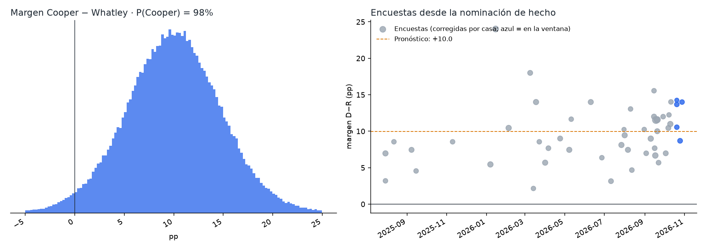
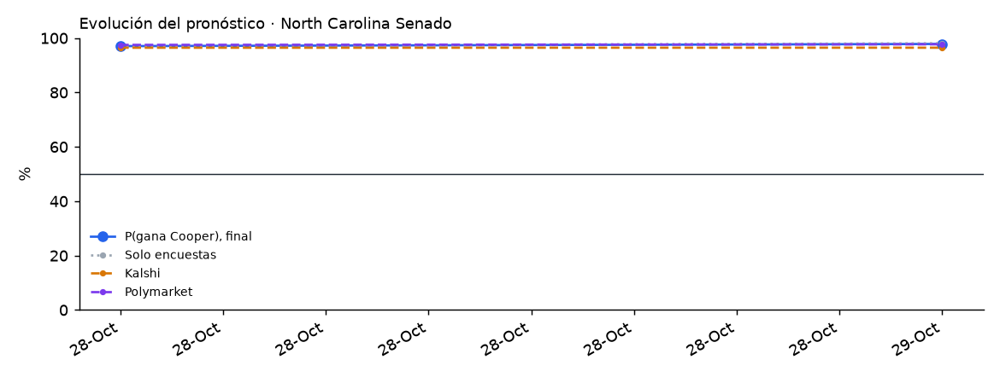

# North Carolina 2026 · Senado

Elección general del 3 de noviembre de 2026 por el escaño que deja Thom Tillis (R): **Roy Cooper (D, exgobernador)** contra **Michael Whatley (R, expresidente del RNC)**, con Shannon Bray (Libertario) y Michael Dublin (Verde). Gana la mayoría simple. Es el primer estado de **Senado** del proyecto.

<!-- PRONOSTICO:INICIO -->
**Pronóstico al 2026-10-29** (5 días a la elección) · actualizado automáticamente 2026-10-29 13:08 ET · fuentes en vivo 9/9

| Senado | % de voto (IC80) | Probabilidad de ganar |
|---|---|---|
| Roy **Cooper** (D) | **53.4%** (50.2–56.7) | **98%** |
| Michael **Whatley** (R) | **43.4%** (40.2–46.7) | **2%** |
| Terceros (Shannon Bray, L; Michael Dublin, Verde) | 3.1% (1.0–5.2) | — |

Margen D−R +10.0 pp (σ 4.9) · solo encuestas: P(Cooper) 98% · Kalshi 96% · Polymarket 98% (peso de mercados 0.3) · recuento a petición (|margen| ≤ 0.26 pp) 0.5% · 49 encuestas, 5 encuestadoras en la ventana

Cómo se llega: promedio de encuestas +12.1 · sesgo estatal de North Carolina -1.8 · mercados -0.3

**Encuesta más reciente:** High Point Univ., terminó el 2026-10-28 (**1 días** antes del corte). Las fuentes se consultan en vivo, pero el promedio solo puede ser tan reciente como la última encuesta publicada.

**Voto anticipado ya emitido** (civicAPI, diagnóstico, al 2026-10-29): 2,150,024 (2,073,467 en persona, 76,557 por correo) · por registro: D 39.8 %, sin afiliación 34.6 %, R 25.3 % (margen D−R +14.6). Es registro partidario, no intención de voto (los sin afiliación son un tercio): no entra al pronóstico.

Detalle: [`resumen.txt`](produccion/salidas/ultimo/resumen.txt) · [encuestas usadas](produccion/salidas/ultimo/encuestas_senado.csv) · [escenarios](produccion/salidas/ultimo/escenarios_senado.csv) · [voto anticipado por condado](produccion/salidas/ultimo/voto_anticipado_condados.csv) · [historial](produccion/salidas/historial_pronosticos.csv)
<!-- PRONOSTICO:FIN -->

GitHub Actions actualiza el bloque anterior dos veces al día ([flujo](../.github/workflows/pronostico_north_carolina.yml)).

## Modelo general (elegido por backtest)
Base: el modelo de Ohio v1.2.0 (Nueva York / Illinois / Texas / Maine / Pennsylvania / Nevada / Florida / Georgia V11). Se validó con un backtest *leave-one-year-out* de 992 contiendas (1998–2024: 383 de Senado, 23 de North Carolina) a 7 días de la elección, con la misma ventana que producción, más una validación estrictamente cronológica.

**¿Sirve el modelo de gobernador para el Senado?** Sí. Se probaron cinco variantes propias del Senado (σ calibrada solo con Senado, sesgo estatal solo con Senado, sesgo nacional del cargo, mezcla con fundamentales y escala del margen) y ninguna mejora a V11 + sesgo estatal en las 383 contiendas de Senado (CRPS 3.347; la mejor alternativa, 3.349).

| Pieza | Cómo entra | Por qué |
|---|---|---|
| Promedio de encuestas | V11: efecto de casa contraído (k = 8), √n, vida media de 14 días, cada firma pesa ~1; ventana de 21 días (hoy, 3 encuestadoras) | Mejor CRPS nacional (3.202) y en el Senado (3.347) |
| Identidad de las encuestas | Firma + periodo de campo; alias de Harper/Carolina Journal y Trafalgar; aisladas: «YouGov» 20-oct de 270toWin (= Elon/YouGov) y Catawba 30-sep (= Catawba/YouGov 4–15 sep) | No contar dos veces la misma encuesta |
| Sesgo estatal | Contraído por Bayes empírico con todas las contiendas del estado: hoy **resta** 2.1 pp | Las encuestas sobreestimaron al demócrata en las 10 contiendas de NC desde 2014; cronológico Senado nacional 3.236 vs 3.474 sin sesgo (P = 0.012) |
| Terceros (Bray, Dublin) | `real = a + c·(otros en las encuestas que los reportan)`, en bloque | Mejor regla en NC y a nivel nacional |
| Indecisos | 50/50 | El reparto proporcional y la cuota R son peores |
| Ventajas grandes | Sin ajuste de escala | b = 1.00 fuera de muestra |
| σ | `√(τ² + s²/k)` calibrada a los días que faltan, t de Student, más una deriva (paseo aleatorio, 0.25 pp por √día) | σ por cargo no mejora; cobertura del 80 % correcta |
| Mercados | Promedio de **Kalshi y Polymarket**, mezcla logit con peso 0.30 | Peso estimado con 40 contiendas de 2024 ([detalle](../arizona/docs/03_peso_mercados.md)) |
| Recuento | P(\|margen\| ≤ 0.26 pp) | A petición si la diferencia es ≤ 10,000 votos (≈ 0.26 pp) |
| Voto anticipado | civicAPI por partido de registro y condado (100) | Diagnóstico, peso 0: registro no es intención de voto |

## Carpetas
| Carpeta | Contenido |
|---|---|
| [`produccion/`](produccion/) | Paquete `nc_pronostico`. Fuentes en vivo: Wikipedia, 270toWin, Kalshi, Polymarket, civicAPI y FiveThirtyEight. Incluye CLI, pruebas sin red y tarea programada de Windows |
| [`backtest/`](backtest/) | Backtest de variantes, pruebas propias del Senado (`revision_senado_north_carolina.py`), validación cronológica del sesgo, sesgo por regla y escala de ventajas grandes |
| [`docs/`](docs/) | Investigación del electorado (registro, voto anticipado), indecisos, contexto, fuentes y decisiones del modelo |
