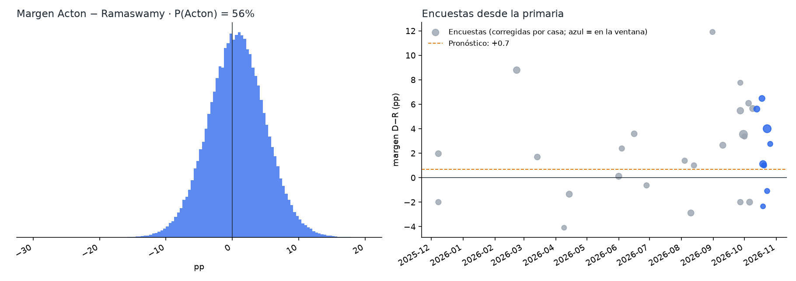
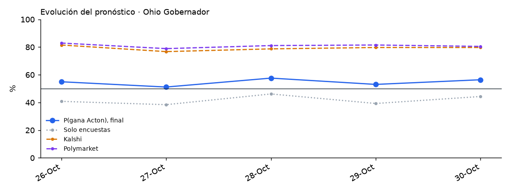

# Ohio 2026 · Gobernador

Elección general del 3 de noviembre de 2026 entre **Amy Acton (D, exdirectora de Salud del estado)** y **Vivek Ramaswamy (R)**, con Don Kissick (Libertario). El gobernador Mike DeWine (R) deja el cargo por límite de mandatos. Gana la mayoría simple.

<!-- PRONOSTICO:INICIO -->
**Pronóstico al 2026-10-30** (4 días a la elección) · actualizado automáticamente 2026-10-30 21:46 ET · fuentes en vivo 9/9

| Gobernador | % de voto (IC80) | Probabilidad de ganar |
|---|---|---|
| Amy **Acton** (D) | **48.9%** (45.9–51.8) | **56%** |
| Vivek **Ramaswamy** (R) | **48.2%** (45.2–51.1) | **44%** |
| Don **Kissick** (L) | 2.9% (0.8–4.9) | 0% |

Margen D−R +0.7 pp (σ 4.4) · solo encuestas: P(Acton) 44% · Kalshi 80% · Polymarket 80% (peso de mercados 0.3) · resultado muy estrecho (|margen| ≤ 0.5) 4.7% · 31 encuestas, 8 encuestadoras en la ventana

**Don Kissick (Libertario):** P(≥ 3 %, el partido conserva su registro en Ohio) **46%** · votos por escrito ~0.1 % · terceros en total 3.0 %

Cómo se llega: promedio de encuestas +2.5 · sesgo estatal de Ohio -3.1 · mercados +1.3

**Encuesta más reciente:** Suffolk University, terminó el 2026-10-26 (**4 días** antes del corte). Las fuentes se consultan en vivo, pero el promedio solo puede ser tan reciente como la última encuesta publicada.

**Voto anticipado ya emitido** (civicAPI, diagnóstico, al 2026-10-30): 1,486,955 (907,037 en persona, 579,918 por correo) · 36 % del total de votos de 2022. Ohio no tiene registro partidario: es solo volumen, no indica el resultado y no entra al pronóstico.

Detalle: [`resumen.txt`](produccion/salidas/ultimo/resumen.txt) · [encuestas usadas](produccion/salidas/ultimo/encuestas_gobernador.csv) · [escenarios](produccion/salidas/ultimo/escenarios_gobernador.csv) · [voto anticipado por condado](produccion/salidas/ultimo/voto_anticipado_condados.csv) · [historial](produccion/salidas/historial_pronosticos.csv)
<!-- PRONOSTICO:FIN -->

GitHub Actions actualiza el bloque anterior dos veces al día ([flujo](../.github/workflows/pronostico_ohio.yml)).

## Modelo general (elegido por backtest)
Base: el modelo de Nueva York v1.1.0 e Illinois v1.1.0 (Texas / Maine / Pennsylvania / Nevada / Florida / Georgia V11). Se validó con un backtest *leave-one-year-out* de 957 contiendas (1998–2024, 24 de Ohio) a 8 días de la elección, con la misma ventana que producción, más una validación estrictamente cronológica.

| Pieza | Cómo entra | Por qué |
|---|---|---|
| Promedio de encuestas | V11: efecto de casa contraído (k = 8), √n, vida media de 14 días, cada firma pesa ~1; ventana de 21 días (hoy, 6 encuestadoras) | Mejor CRPS nacional (3.249) |
| Identidad de las encuestas | Firma + periodo de campo; NYT/Siena, SSRS, Beacon/Shaw y BGSU con sus alias; cifras y n de la publicación original (Marist LV 50–43, ActiVote 48.6–51.4) | Conservan su efecto de casa y sus cifras |
| Sesgo estatal | Contraído por Bayes empírico con todas las contiendas del estado: hoy **resta** ~4.0 pp | Las encuestas sobreestimaron al demócrata en todas las contiendas de OH desde 2014; LOYO 2.066 vs 2.478 sin sesgo; cronológico 1.802 vs 2.464 (P = 0.002) |
| Terceros (Kissick) | `real = a + c·(otros en las encuestas que los reportan)`; Kissick = terceros − votos por escrito (~0.1 %), con P(≥ 3 %) (umbral para que el Partido Libertario conserve su registro) | Mejor regla en OH y a nivel nacional; no cambia el margen ni P(D) |
| Indecisos | 50/50 | El reparto proporcional y la cuota R son peores |
| Ventajas grandes | Sin ajuste de escala | b = 1.00 fuera de muestra |
| σ | `√(τ² + s²/k + 0.25²·d)` calibrada a los días que faltan, t de Student; d = días que las encuestas son más viejas que el horizonte. La deriva es un paseo aleatorio: la sd adicional crece con √d (0.25 pp por √día) | Cobertura del 80 % correcta en el backtest |
| Mercados | Promedio de **Kalshi y Polymarket**, mezcla logit con peso 0.30 | Peso estimado con 40 contiendas de 2024 ([detalle](../arizona/docs/03_peso_mercados.md)). Hoy los mercados (~82 %) están muy por encima de las encuestas corregidas (41 %): el peso 0.15/0.50 da 48 %/64 % |
| Recuento | P(\|margen\| ≤ 0.25 pp) | Recuento automático en OH |
| Voto anticipado | civicAPI por condado (88), sin partido | Diagnóstico, peso 0 |

## Carpetas
| Carpeta | Contenido |
|---|---|
| [`produccion/`](produccion/) | Paquete `oh_pronostico`. Fuentes en vivo: Wikipedia, 270toWin, Kalshi, Polymarket, civicAPI y FiveThirtyEight. Incluye CLI, pruebas sin red y tarea programada de Windows |
| [`backtest/`](backtest/) | Backtest de variantes (sesgo estatal, indecisos, encuestas partidistas, terceros), validación cronológica del sesgo, sesgo por regla y escala de ventajas grandes |
| [`docs/`](docs/) | Investigación del electorado (independientes, lealtad, voto anticipado), indecisos, contexto, fuentes y decisiones del modelo |
