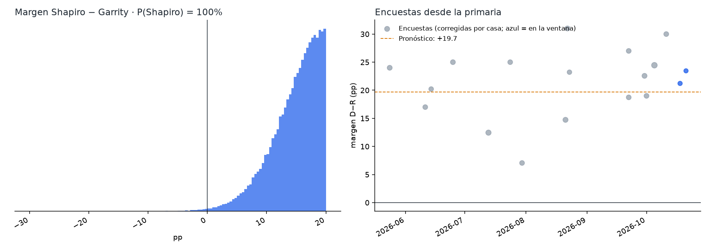
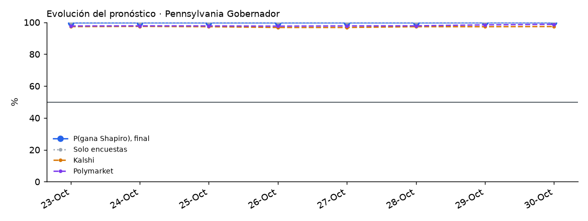

# Pennsylvania 2026 · Gobernador

Elección general del 3 de noviembre de 2026 entre **Josh Shapiro (D, gobernador en funciones)** y **Stacy Garrity (R, tesorera estatal)**. En la boleta también aparece Ken Krawchuk (libertario).

<!-- PRONOSTICO:INICIO -->
**Pronóstico al 2026-10-30** (4 días a la elección) · actualizado automáticamente 2026-10-30 12:48 ET · fuentes en vivo 8/8

| Gobernador | % de voto (IC80) | Probabilidad de ganar |
|---|---|---|
| Josh **Shapiro** (D, gobernador) | **58.8%** (54.5–63.1) | **>99%** |
| Stacy **Garrity** (R) | **39.2%** (34.8–43.5) | **<1%** |
| Terceros | 2.0% (0.1–4.4) | — |

Margen D−R +19.7 pp (σ 6.6) · solo encuestas: P(Shapiro) >99% · Kalshi 97% · Polymarket 99% (peso de mercados 0.3) · recuento automático 0.1% · 18 encuestas, 2 encuestadoras en la ventana

Cómo se llega: promedio de encuestas +22.4 · sesgo estatal de Pennsylvania -0.4 · mercados -2.3

**Encuesta más reciente:** ActiVote, terminó el 2026-10-21 (**9 días** antes del corte). Las fuentes se consultan en vivo, pero el promedio solo puede ser tan reciente como la última encuesta publicada.

**Boletas por correo devueltas** (civicAPI, diagnóstico, al 2026-10-30): 1,005,724 · registrados D 64.9% · R 25.2% · sin partido y otros 9.9%. PA no tiene voto anticipado en persona y el correo es muy demócrata por hábito: no indica el resultado y no entra al pronóstico.

Detalle: [`resumen.txt`](produccion/salidas/ultimo/resumen.txt) · [encuestas usadas](produccion/salidas/ultimo/encuestas_gobernador.csv) · [escenarios](produccion/salidas/ultimo/escenarios_gobernador.csv) · [voto anticipado por condado](produccion/salidas/ultimo/voto_anticipado_condados.csv) · [historial](produccion/salidas/historial_pronosticos.csv)
<!-- PRONOSTICO:FIN -->

GitHub Actions actualiza el bloque anterior dos veces al día ([flujo](../.github/workflows/pronostico_pennsylvania.yml)).

## Modelo general (elegido por backtest)
Base: el modelo de Nevada v1.1.0 (Florida v1.1.0 / Georgia V11). El componente de encuestas se validó con un backtest *leave-one-year-out* de 902 contiendas (1998–2024, 24 de Pennsylvania) a 11 días de la elección, con la misma ventana que producción, más una validación estrictamente cronológica.

| Pieza | Cómo entra | Por qué |
|---|---|---|
| Promedio de encuestas | V11: efecto de casa contraído (k = 8), √n, vida media de 14 días, cada firma pesa ~1; ventana de 21 días, ampliada si hay menos de 2 encuestadoras. Si una encuesta trae LV y RV se usa la LV | Mejor CRPS nacional (3.391) |
| Encuestadoras con varios nombres | PennLive = Bravo Group; NYT/Inquirer/Siena con una sola clave | Evita contar dos veces la misma encuesta y separar su efecto de casa |
| Sesgo estatal | Contraído por Bayes empírico: hoy se restan ~1.0 pp (las encuestas en PA sobreestimaron al demócrata) | En PA quitarlo no es mejor ni peor (3.312 vs 3.320, P = 0.52; cronológico P = 0.52). Mejor a nivel nacional en la prueba por contienda (P = 0.002 cronológico; no concluyente con bootstrap por año). Desde 2016 las encuestas sobreestimaron al demócrata salvo en 2022. «Sin sesgo» se reporta siempre |
| Encuestas internas de campaña | Con su efecto de casa; el ajuste por patrocinador queda como escenario | P1, P2 y P3 son peores en PA |
| Terceros | `real = a + c·(otros en las encuestas que los reportan)`; si ninguna los reporta, media histórica | Calibrado con el resultado real (100 − D − R) |
| Indecisos | 50/50 | El reparto proporcional es el peor en PA (3.912) y a nivel nacional |
| Ventajas grandes | Sin ajuste por paliza | En 357 contiendas con ventaja ≥ 15 pp, la escala estimada del margen es 0.99 y no mejora |
| σ | `√(τ² + s²/k)` calibrada a los días que faltan, t de Student, más una deriva de 0.25 pp/día si las encuestas son más viejas que ese horizonte | Cobertura del 80 % correcta en el backtest |
| Mercados | Promedio de **Kalshi y Polymarket**, mezcla logit con peso 0.30; la distribución del margen se desplaza para que P(margen > 0) sea la probabilidad publicada | Peso óptimo 0.30 también en las contiendas de 2024 con mercados extremos (< 0.1 o > 0.9). Con probabilidades cercanas a 1 la mezcla baja el margen aunque los mercados también den ganador a Shapiro: para el margen, «sin mercados» y Polymarket por rangos son lecturas igual de defendibles |
| Recuento automático | P(\|margen\| ≤ 0.5 pp) | Ley de PA |
| Escenarios | Cruce 2 × 2 de sesgo × mercados, influencia de cada encuesta, terceros, peso de mercados 0.15 y 0.50 | Igual que Nevada |
| Boletas por correo (civicAPI) | Diagnóstico, peso 0 | PA no tiene voto anticipado en persona y el correo es muy demócrata por hábito |

## Qué valida y qué no valida el backtest

*Auditoría transversal del 26-oct-2026 (T4, T7). Detalle en [`docs/auditoria_2026-10-26.md`](../docs/auditoria_2026-10-26.md).*

- **Qué valida.** El backtest *leave-one-year-out* sobre el histórico de FiveThirtyEight + 2024 valida el **componente de encuestas** (promedio, efectos de casa, sesgo estatal) y su distribución de error (τ, s, ν). El número de contiendas depende del horizonte: con el corte de la corrida del 25/26-oct (9 días) la calibración de producción usa **945 contiendas**.
- **Qué no valida.** No es un backtest del pronóstico final que mezcla Kalshi/Polymarket con peso `w = 0.30`. Ese peso se estudió aparte con **40 contiendas de 2024** (un solo ciclo, con errores correlacionados): `w` de máxima verosimilitud 0.65 sin sesgo común y 0.25 con sesgo común libre (IC95 0–0.65). `w = 0.30` es compatible con ambos, no una validación entre ciclos. Ver [`arizona/docs/03_peso_mercados.md`](../arizona/docs/03_peso_mercados.md).
- **Margen y ganador son cosas distintas.** CRPS y MAE miden el margen; Brier y log score, el ganador. Una variante puede mejorar uno y no el otro.
- **Significancia.** Los valores P de esta página y de `docs/` comparan variantes **contienda por contienda**, como si las contiendas de un mismo año fueran independientes. Con bootstrap **por año** (26 años, 4,000 réplicas, 945 contiendas), la corrección por sesgo estatal mejora el CRPS nacional en −0.134, pero con IC95 [−0.320, +0.051], que incluye el cero (fracción de réplicas con empeoramiento: 0.077), y el Brier no cambia (+0.0009, IC95 [−0.004, +0.006]). La mejora observada es real en la muestra; la evidencia no alcanza para afirmar una ventaja robusta al 95 % entre ciclos. Se mantiene la regla vigente: se fijó antes de la elección y no se cambia con estos datos.
- **Fechas del histórico (T1).** FiveThirtyEight fecha cada encuesta en la mediana de su campo; producción usa el cierre. Recalibrar suponiendo que cada encuesta histórica estuvo disponible 2–4 días después de su mediana **no ensancha σ** (baja 0.1–0.3 pp; ν baja de 19.5 a ~13): no hay evidencia para aumentar la incertidumbre.

## Carpetas
| Carpeta | Contenido |
|---|---|
| [`produccion/`](produccion/) | Paquete `pa_pronostico`. Todas las fuentes en vivo: Wikipedia, 270toWin, Kalshi, Polymarket, civicAPI y FiveThirtyEight. Incluye CLI, pruebas sin red y tarea programada de Windows |
| [`backtest/`](backtest/) | Backtest de variantes (sesgo estatal, indecisos, encuestas internas, terceros, escala del margen) y errores históricos de las encuestas en PA |
| [`docs/`](docs/) | Investigación del electorado (registro, correo, indecisos), contexto de la campaña, fuentes y decisiones del modelo |
