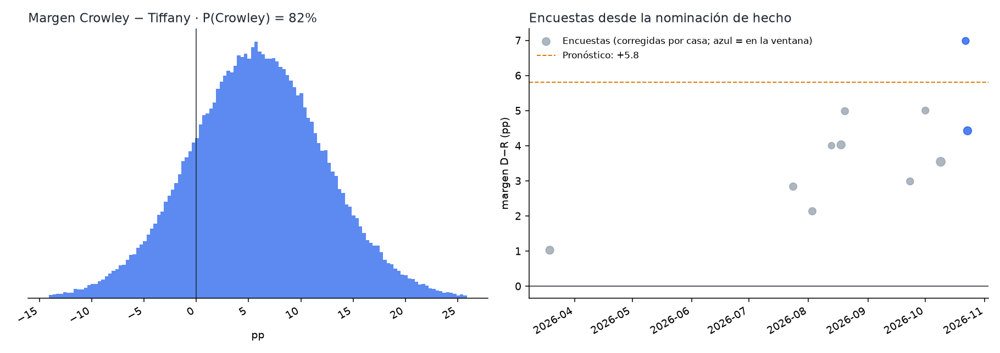
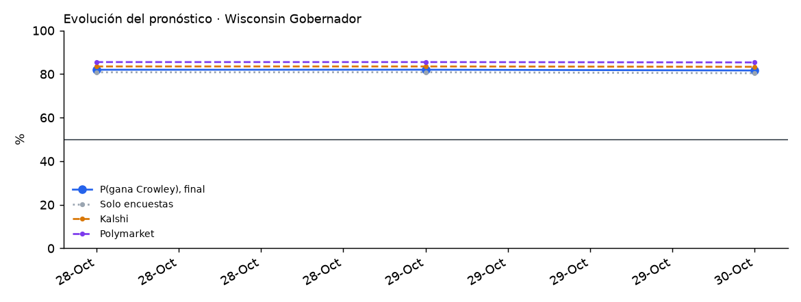

# Wisconsin 2026 · Gobernador

Elección general del 3 de noviembre de 2026 entre **David Crowley (D, ejecutivo del condado de Milwaukee)** y **Tom Tiffany (R, congresista del distrito 7)**. Solo ellos dos están en la boleta (más votos por escrito). El gobernador Tony Evers (D) no busca un tercer periodo. Gana la mayoría simple.

<!-- PRONOSTICO:INICIO -->
**Pronóstico al 2026-10-30** (4 días a la elección) · actualizado automáticamente 2026-10-30 11:57 CT · fuentes en vivo 9/9

| Gobernador | % de voto (IC80) | Probabilidad de ganar |
|---|---|---|
| David **Crowley** (D) | **52.8%** (48.7–57.0) | **82%** |
| Tom **Tiffany** (R) | **47.0%** (42.9–51.2) | **18%** |
| Votos por escrito | 0.1% (0.1–0.2) | — |

Margen D−R +5.8 pp (σ 6.6) · solo encuestas: P(Crowley) 80% · Kalshi 83% · Polymarket 85% (peso de mercados 0.3) · recuento a petición (|margen| ≤ 1 pp) 8.1% · 11 encuestas, 2 encuestadoras en la ventana

**Encuesta más reciente:** Wick (R), terminó el 2026-10-23 (**7 días** antes del corte). Las fuentes se consultan en vivo, pero el promedio solo puede ser tan reciente como la última encuesta publicada.

**Voto anticipado ya emitido** (civicAPI, diagnóstico, al 2026-10-30): 1,086,959 (393,625 en persona, 693,334 por correo) · 41 % del total de votos de gobernador 2022. Wisconsin no tiene registro partidario: es solo volumen, no indica el resultado y no entra al pronóstico.

Detalle: [`resumen.txt`](produccion/salidas/ultimo/resumen.txt) · [encuestas usadas](produccion/salidas/ultimo/encuestas_gobernador.csv) · [escenarios](produccion/salidas/ultimo/escenarios_gobernador.csv) · [voto anticipado por condado](produccion/salidas/ultimo/voto_anticipado_condados.csv) · [historial](produccion/salidas/historial_pronosticos.csv)
<!-- PRONOSTICO:FIN -->

GitHub Actions actualiza el bloque anterior dos veces al día ([flujo](../.github/workflows/pronostico_wisconsin.yml)).

## Modelo general (elegido por backtest)
Base: el modelo de North Carolina v1.0.0 / Ohio v1.2.0 (Georgia V11) con la **regla de Arizona: sin sesgo estatal**. Se validó con un backtest *leave-one-year-out* de 1003 contiendas (1998–2024, 25 de Wisconsin) a 6 días de la elección, con la misma ventana que producción, más una validación estrictamente cronológica.

| Pieza | Cómo entra | Por qué |
|---|---|---|
| Promedio de encuestas | V11: efecto de casa contraído (k = 8), √n, vida media de 14 días, cada firma pesa ~1; ventana de 21 días (hoy, 2 encuestadoras: Marquette y Wick) | Mejor CRPS nacional (3.158) |
| Identidad de las encuestas | Firma + periodo de campo; Marquette, TIPP, Badger Battleground/Platform, RMG y YouGov/City Forward con sus alias | Conservan su efecto de casa y no se cuentan dos veces |
| Sesgo estatal | **No se aplica** (escenario: −0.50 pp) | El error de las encuestas en WI cambia de signo (presidente 2016 +5.9 y 2020 +7.4 pro-D; gobernador 2022 −4.1 pro-R); LOYO WI 2.630 sin sesgo vs 2.822 (P = 0.88); gobernador WI 2.924 vs 3.147 (P = 0.93) |
| Terceros | Solo dos candidatos en la boleta: votos por escrito fijos (0.10 ± 0.05 %) | Como Nueva York |
| Indecisos | 50/50 | El reparto proporcional y la cuota R son peores |
| Ventajas grandes | Sin ajuste de escala | b = 1.00 fuera de muestra |
| σ | `√(τ² + s²/k)` calibrada a los días que faltan, t de Student, más una deriva (paseo aleatorio, 0.25 pp por √día) | Cobertura del 80 % correcta en el backtest |
| Mercados | Promedio de **Kalshi y Polymarket**, mezcla logit con peso 0.30 | Peso estimado con 40 contiendas de 2024 ([detalle](../arizona/docs/03_peso_mercados.md)) |
| Recuento | P(\|margen\| ≤ 1 pp) | Recuento a petición si se pierde por ≤ 1 % |
| Voto anticipado | civicAPI por condado (72), sin partido | Diagnóstico, peso 0 |

## Carpetas
| Carpeta | Contenido |
|---|---|
| [`produccion/`](produccion/) | Paquete `wi_pronostico`. Fuentes en vivo: Wikipedia, 270toWin, Kalshi, Polymarket, civicAPI y FiveThirtyEight. Incluye CLI, pruebas sin red y tarea programada de Windows |
| [`backtest/`](backtest/) | Backtest de variantes (sesgo estatal, indecisos, encuestas partidistas, terceros), variantes por cargo, validación cronológica del sesgo y escala de ventajas grandes |
| [`docs/`](docs/) | Investigación del electorado (independientes, participación, voto anticipado), indecisos, contexto, fuentes y decisiones del modelo; [revisión externa del 28-oct](docs/02_revision_externa_2026-10-28.md) |
